

  

  


I build the software that lets laboratory analyzers and hospital systems talk to each other. At **CareTech** I work on the integration layer of a Hospital Information System: middleware that takes raw **ASTM** and **HL7** output from 50+ analyzers across 12+ brands and delivers it to the LIS in real time, with no manual data entry.

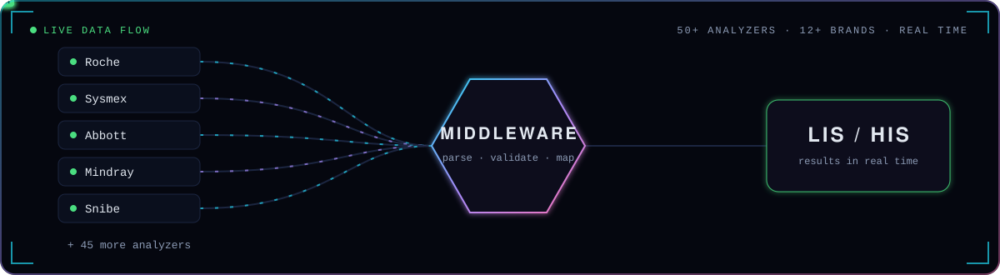


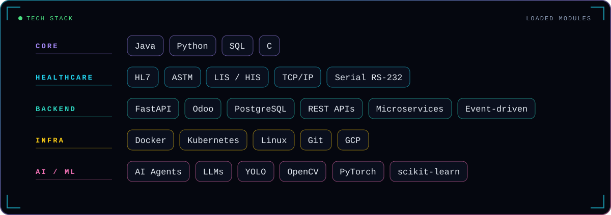


  <a href="https://github.com/green-thunder/claude-code-account-switcher">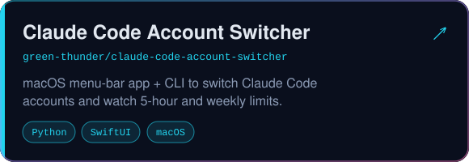</a>
  <a href="https://github.com/green-thunder/smart_traffic_analyzer">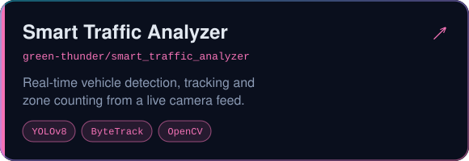</a>
  <a href="https://github.com/green-thunder/http-server-python">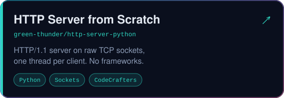</a>
  <a href="https://github.com/green-thunder/environmental_sensing_node_state_classification">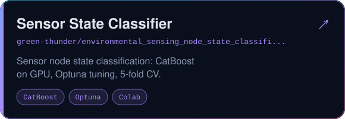</a>
  <a href="https://github.com/green-thunder/FinalPresentation-IBM_DataScience">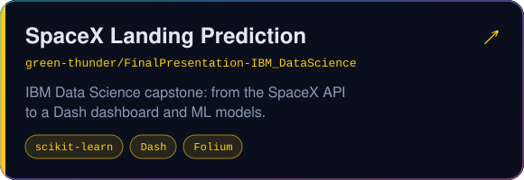</a>
  <a href="https://github.com/green-thunder/leetcode">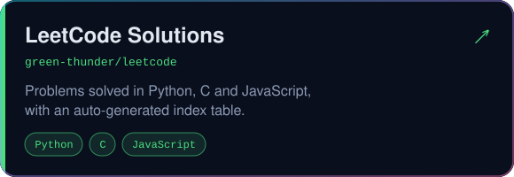</a>

<picture>
  <source media="(prefers-color-scheme: dark)" srcset="https://raw.githubusercontent.com/green-thunder/green-thunder/output/snake-dark.svg">
  <source media="(prefers-color-scheme: light)" srcset="https://raw.githubusercontent.com/green-thunder/green-thunder/output/snake-light.svg">
  
</picture>
