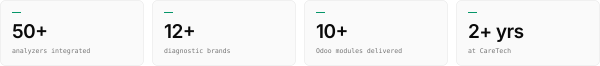
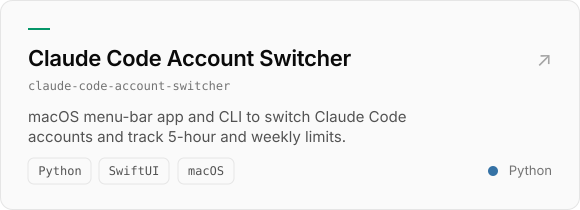
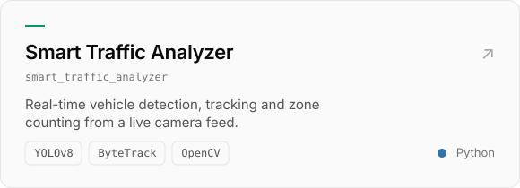
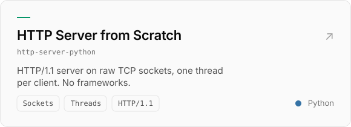
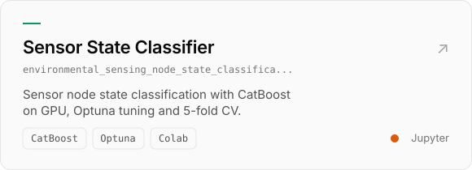
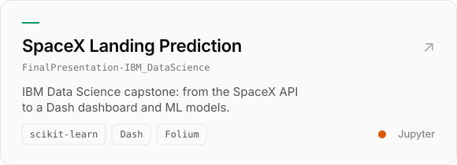
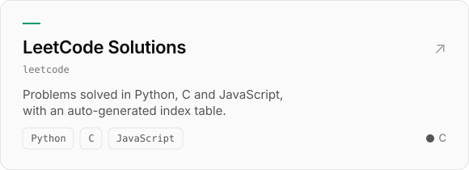
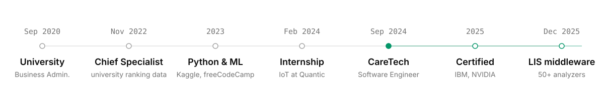

<picture><source media="(max-width: 600px) and (pointer: coarse)" srcset="assets/overview-m-dark.svg"><source media="(prefers-color-scheme: dark)" srcset="assets/overview-dark.svg"></picture>

<picture><source media="(max-width: 600px) and (pointer: coarse)" srcset="assets/metrics-m-dark.svg"><source media="(prefers-color-scheme: dark)" srcset="assets/metrics-dark.svg"></picture>

### What I do

At CareTech I build the integration layer of a Hospital Information System. Laboratory analyzers from Roche, Sysmex, Abbott, Mindray, Snibe and others speak their own ASTM and HL7 dialects; my middleware parses them, validates the results and delivers them to the LIS in real time, so nobody retypes lab results by hand.

### Featured work

  <a href="https://github.com/green-thunder/claude-code-account-switcher"><picture><source media="(max-width: 600px) and (pointer: coarse)" srcset="assets/work/claude-code-account-switcher-m-dark.svg"><source media="(prefers-color-scheme: dark)" srcset="assets/work/claude-code-account-switcher-dark.svg"></picture></a>
  <a href="https://github.com/green-thunder/smart_traffic_analyzer"><picture><source media="(max-width: 600px) and (pointer: coarse)" srcset="assets/work/smart_traffic_analyzer-m-dark.svg"><source media="(prefers-color-scheme: dark)" srcset="assets/work/smart_traffic_analyzer-dark.svg"></picture></a>
  <a href="https://github.com/green-thunder/http-server-python"><picture><source media="(max-width: 600px) and (pointer: coarse)" srcset="assets/work/http-server-python-m-dark.svg"><source media="(prefers-color-scheme: dark)" srcset="assets/work/http-server-python-dark.svg"></picture></a>
  <a href="https://github.com/green-thunder/environmental_sensing_node_state_classification"><picture><source media="(max-width: 600px) and (pointer: coarse)" srcset="assets/work/environmental_sensing_node_state_classification-m-dark.svg"><source media="(prefers-color-scheme: dark)" srcset="assets/work/environmental_sensing_node_state_classification-dark.svg"></picture></a>
  <a href="https://github.com/green-thunder/FinalPresentation-IBM_DataScience"><picture><source media="(max-width: 600px) and (pointer: coarse)" srcset="assets/work/FinalPresentation-IBM_DataScience-m-dark.svg"><source media="(prefers-color-scheme: dark)" srcset="assets/work/FinalPresentation-IBM_DataScience-dark.svg"></picture></a>
  <a href="https://github.com/green-thunder/leetcode"><picture><source media="(max-width: 600px) and (pointer: coarse)" srcset="assets/work/leetcode-m-dark.svg"><source media="(prefers-color-scheme: dark)" srcset="assets/work/leetcode-dark.svg"></picture></a>

### Path

<picture><source media="(max-width: 600px) and (pointer: coarse)" srcset="assets/timeline-phone.svg"><source media="(prefers-color-scheme: dark)" srcset="assets/timeline-dark.svg"></picture>

### Stack

<picture><source media="(max-width: 600px) and (pointer: coarse)" srcset="assets/stack-phone.svg"><source media="(prefers-color-scheme: dark)" srcset="assets/stack-dark.svg"></picture>
