<picture>
  <source media="(prefers-color-scheme: dark)" srcset="assets/header-dark.svg">
  
</picture>

I build the integration layer between laboratory analyzers and hospital information systems at **CareTech**: middleware that takes raw ASTM and HL7 output from 50+ analyzers across 12+ brands and delivers it to the LIS in real time.

**Stack** &nbsp;`Java` `Python` `PostgreSQL` `Odoo` `FastAPI` `HL7` `ASTM` `Docker` `Kubernetes`

**Work**

- [claude-code-account-switcher](https://github.com/green-thunder/claude-code-account-switcher): macOS menu-bar app and CLI to switch Claude Code accounts and track usage limits
- [smart_traffic_analyzer](https://github.com/green-thunder/smart_traffic_analyzer): real-time vehicle detection, tracking and zone counting with YOLOv8
- [http-server-python](https://github.com/green-thunder/http-server-python): HTTP/1.1 server built from scratch on raw sockets
- [environmental_sensing_node_state_classification](https://github.com/green-thunder/environmental_sensing_node_state_classification): sensor state classification with CatBoost and Optuna
- [FinalPresentation-IBM_DataScience](https://github.com/green-thunder/FinalPresentation-IBM_DataScience): IBM Data Science capstone, SpaceX landing prediction
- [leetcode](https://github.com/green-thunder/leetcode): solutions in Python, C and JavaScript

[LinkedIn](https://www.linkedin.com/in/nodirbek-kamalov/)
